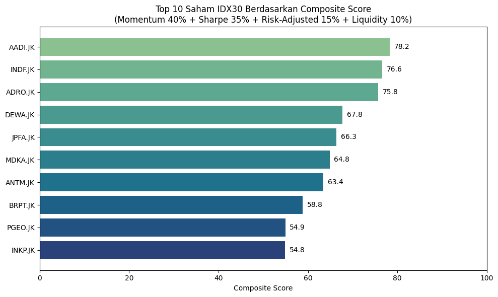
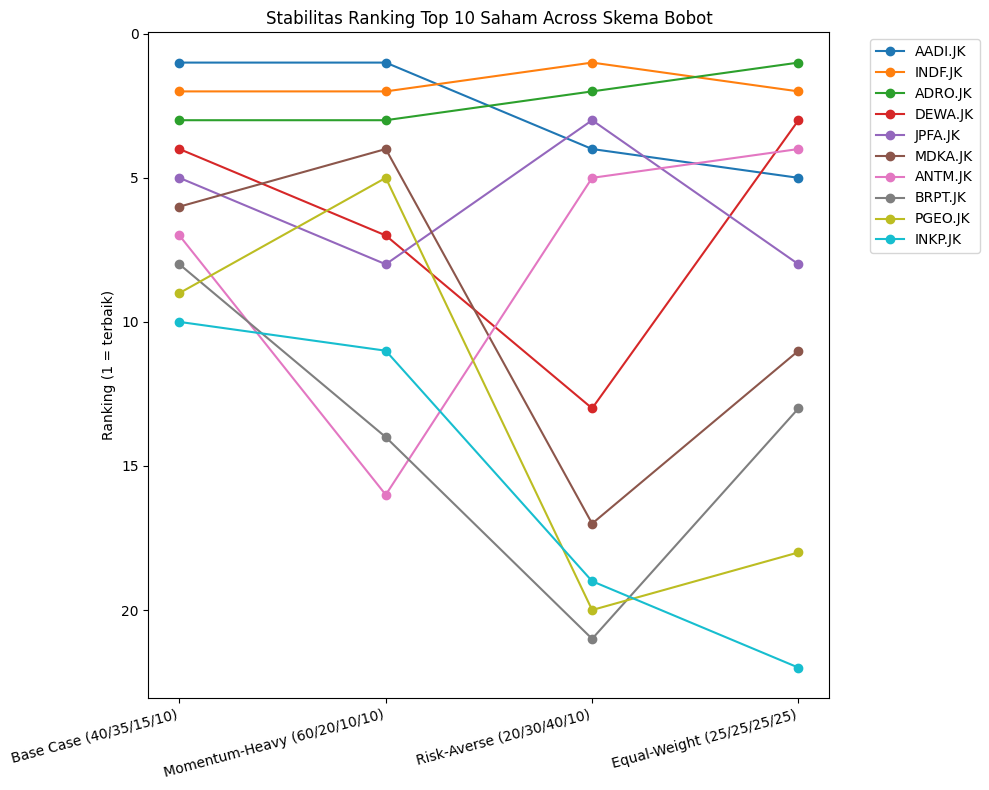

# IDX30 Momentum & Risk Screener

**Project 1 of 5.** A multi-factor stock screener that ranks the 30 IDX30 constituents on momentum, risk-adjusted quality, and liquidity, then stress-tests the ranking against different weighting choices.

## Problem

A trader or analyst can't research 30 stocks in depth at once. The screener narrows the universe to a short list of candidates using transparent, reproducible rules.

## Data

- **Universe:** 30 IDX30 constituents (3 Aug – 30 Oct 2026 composition)
- **Period:** 2 years of daily prices and volume (14 Aug 2024 – 13 Aug 2026, 479 trading days)
- **Source:** Yahoo Finance via `yfinance`

## Method

1. **Raw metrics per stock**
   - Momentum: 3-month (63-day) and 6-month (126-day) return
   - Risk-adjusted quality: annualized volatility, Sharpe ratio (6% risk-free rate), maximum drawdown
   - Liquidity: 6-month average daily volume
2. **Normalization:** each metric converted to a 0–100 percentile rank (volatility and drawdown reversed, so lower risk scores higher)
3. **Composite score:** Momentum 40% · Sharpe 35% · Volatility/Drawdown 15% · Liquidity 10%
4. **Sensitivity analysis:** re-rank under 4 weighting schemes to check whether the top picks are robust or just a product of the chosen weights

## Key results

**Top 5 (base case weights)**

| Rank | Stock | Composite score |
|---|---|---|
| 1 | AADI | 78.2 |
| 2 | INDF | 76.6 |
| 3 | ADRO | 75.8 |
| 4 | DEWA | 67.8 |
| 5 | JPFA | 66.3 |

**Robustness across weighting schemes**

| Scheme (Mom / Sharpe / Risk / Liq) | Top 5 |
|---|---|
| Base case (40/35/15/10) | AADI, INDF, ADRO, DEWA, JPFA |
| Momentum-heavy (60/20/10/10) | AADI, INDF, ADRO, MDKA, PGEO |
| Risk-averse (20/30/40/10) | INDF, ADRO, JPFA, AADI, ANTM |
| Equal-weight (25/25/25/25) | ADRO, INDF, DEWA, ANTM, AADI |

- **AADI, INDF, and ADRO are in the top 5 under all four schemes**, including the two opposite philosophies (momentum-heavy vs risk-averse), so their ranking is not an artifact of the weights.
- **DEWA is weight-sensitive:** rank 4 in the base case but 13 under risk-averse weights. It has the highest Sharpe in the universe but the worst volatility, a high-risk, high-reward profile.
- **CPIN, KLBF, and EMTK stay in the bottom 5 under every scheme.**

**Diversification:** the return correlation heatmap shows the large banks (BBCA, BBNI, BBRI, BMRI) moving closely together, so holding several of them adds little diversification.

## Limitations

- Backward-looking: all metrics come from 2 years of history.
- Price and volume only; no fundamentals (P/E, P/B, ROE) or macro/sentiment factors.
- Base weights are subjective, although tested with 4 alternatives.
- AADI has ~16% missing history (later listing), so its metrics rest on a shorter sample.

## Next step in the workflow

The screener produces candidates. [Project 2](../02-idxbumn20-portfolio-optimizer/) decides how much capital to put in each.

## Run

Open `idx30_momentum_risk_screener.ipynb` after installing the root `requirements.txt`.
