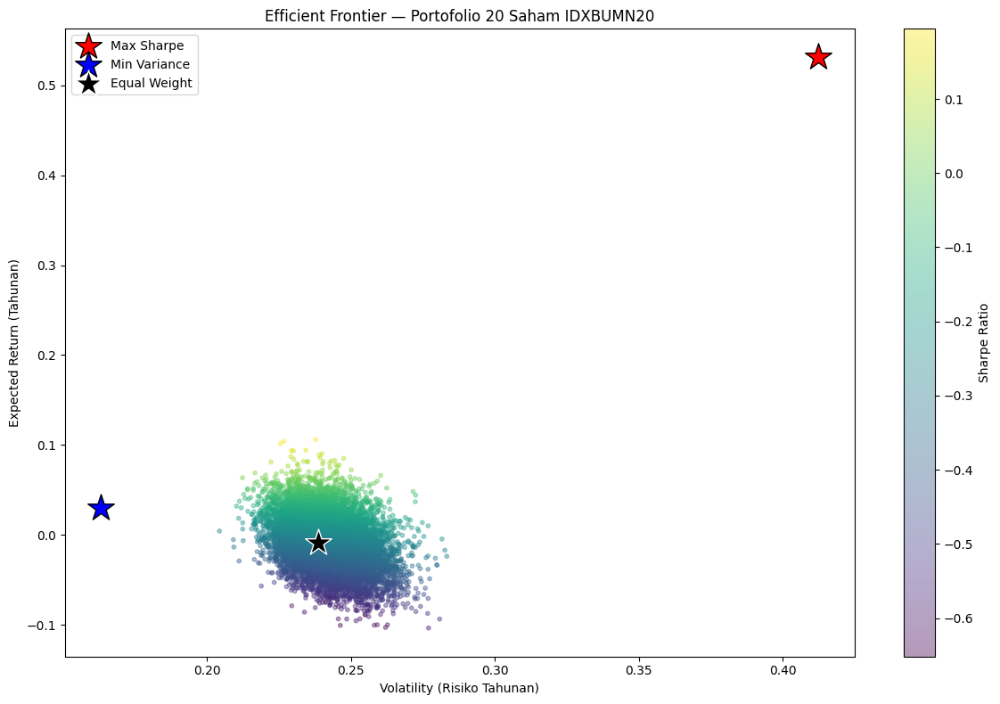

# IDXBUMN20 Portfolio Optimizer

**Project 2 of 5.** Mean-variance (Markowitz) portfolio optimization on the 20 state-owned-enterprise stocks in the IDXBUMN20 index, comparing Monte Carlo sampling with mathematical optimization.

## Problem

After choosing which stocks to hold, the next decision is how much to put in each one. This project finds the allocation with the best risk-return trade-off and compares it with simpler alternatives.

## Data

- **Universe:** 20 IDXBUMN20 constituents (BBRI, BMRI, TLKM, ANTM, PGAS, PTBA, BBNI, ADHI, SMGR, JSMR, BRIS, PTPP, BBTN, ELSA, PGEO, BJTM, AGRO, BJBR, SMBR, MTEL)
- **Period:** 2 years of daily prices (22 Aug 2024 – 21 Aug 2026, 479 trading days)
- **Source:** Yahoo Finance via `yfinance`

## Method

1. Annualized return, volatility, Sharpe ratio (6% risk-free rate) and correlation matrix from daily returns
2. **Monte Carlo:** 10,000 random long-only portfolios to map the risk-return space
3. **Optimization:** `scipy.optimize.minimize` (SLSQP), long-only, weights sum to 1
   - Maximum Sharpe ratio portfolio
   - Minimum variance portfolio
4. Comparison against an **equal-weight** (5% each) baseline

## Key results

| Strategy | Expected return | Volatility | Sharpe |
|---|---|---|---|
| **Max Sharpe** | 53.1% | 41.3% | **1.14** |
| Min Variance | 3.0% | 16.3% | −0.18 |
| Equal Weight | −0.8% | 23.9% | −0.29 |

- **Max Sharpe concentrates in 2 stocks:** ANTM (60.8%) and ELSA (39.2%), the only two names with strongly positive individual Sharpe ratios (1.05 and 0.74).
- **Min Variance spreads across 8 stocks and 4 sectors:** BJTM 37.8%, BJBR 18.8%, PTBA 15.6%, MTEL 12.5%, JSMR 7.2%, PGAS 4.3%, ELSA 3.3%, TLKM 0.5%, reaching the lowest volatility (16.3%).
- **Random sampling misses the optimum:** the best of 10,000 Monte Carlo portfolios reached a Sharpe of only 0.20, versus 1.14 from the optimizer. In 20 dimensions, random weights almost never land on a concentrated corner solution.
- **2 of 3 strategies have negative Sharpe**, meaning they underperformed the risk-free rate. Most IDXBUMN20 stocks were under pressure during this period, so the problem was the universe, not only the weights.

## Limitations

- Backward-looking: weights are fitted on 2 years of history.
- Markowitz assumes normally distributed returns.
- Max Sharpe is too concentrated to be practical; a maximum-weight constraint per stock would give a more realistic portfolio.
- Fixed risk-free rate; no transaction costs or taxes.

## Next step in the workflow

With weights decided, [Project 3](../03-lq45-risk-management-dashboard/) measures how much a portfolio can lose on a bad day and how to hedge it.

## Run

Open `idxbumn20_portfolio_optimizer.ipynb` after installing the root `requirements.txt`.
