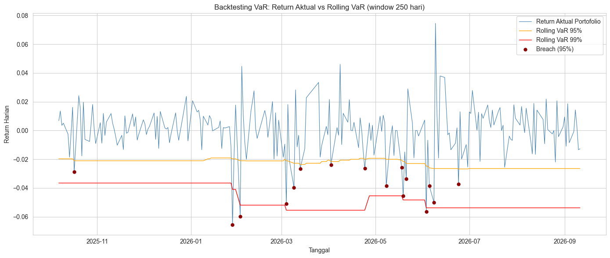
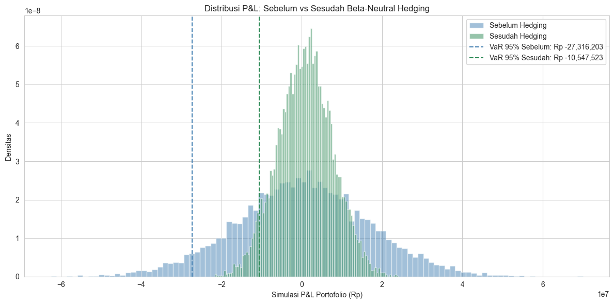

# LQ45 Risk Management Dashboard

**Project 3 of 5.** Market-risk analysis of an LQ45 portfolio: CAPM betas, Monte Carlo and historical VaR/CVaR, statistical VaR backtesting, and a beta-neutral hedge.

## Problem

A portfolio manager needs to know how much the portfolio can lose on a bad day, whether that estimate can be trusted, and how to reduce exposure to the overall market without selling the stocks.

## Data

- **Universe:** LQ45 constituents (3 Aug – 30 Oct 2026 composition); AADI dropped for insufficient history, leaving **44 stocks**
- **Market proxy:** IHSG (`^JKSE`)
- **Period:** 13 Sep 2024 – 11 Sep 2026 (477 trading days)
- **Portfolio:** Rp 1 billion, equal-weight, 1-day horizon

## Method

1. **CAPM regression** per stock (`scipy.stats.linregress`) to estimate beta and alpha against IHSG
2. **VaR & CVaR** at 95% and 99%: Monte Carlo (10,000 multivariate-normal scenarios) compared with historical simulation
3. **VaR backtesting:** rolling 250-day historical VaR, breach counting, and Kupiec proportion-of-failures test
4. **Beta-neutral hedging:** short the index by portfolio beta × portfolio value, then re-simulate stocks and market jointly

## Key results

**Systematic risk (CAPM)**
- Most aggressive: CUAN (β 2.27), DEWA (2.20), BRPT (2.07)
- Most defensive: ITMG (β 0.30), INDF (0.42), ICBP (0.49)
- Equal-weight portfolio beta: **1.04**, almost identical to the market

**VaR/CVaR (Rp 1B portfolio, 1 day)**

| Measure | Monte Carlo (normal) | Historical |
|---|---|---|
| VaR 95% | Rp −26.3 M | Rp −24.2 M |
| CVaR 95% | Rp −33.1 M | Rp −41.0 M |
| VaR 99% | Rp −37.3 M | Rp −50.2 M |
| CVaR 99% | Rp −42.4 M | **Rp −67.3 M** |

The normal-distribution Monte Carlo **underestimates tail risk**: at 99%, historical CVaR is ~59% larger. Real IDX returns have fat tails.

**Backtesting (227 out-of-sample days)**

| Level | Breaches | Breach rate | Expected | Kupiec p-value |
|---|---|---|---|---|
| 95% | 16 | 7.05% | 5% | 0.181 ✅ |
| 99% | 3 | 1.32% | 1% | 0.643 ✅ |

Both levels pass Kupiec, but breaches **cluster in early 2026** (volatility clustering), and the worst breach overshot VaR by Rp 45.8 M. That is why CVaR matters: VaR flags a breach but not its size.

**Beta-neutral hedge**
- Short notional required: **Rp 1.04 B**
- Simulated P&L standard deviation: Rp 16.5 M → Rp 6.8 M (**−59%**)
- VaR 95%: Rp −27.3 M → Rp −10.5 M (**−61%**)

Most of the portfolio's risk is market (systematic) risk, consistent with a beta near 1.

## Limitations

- Monte Carlo assumes normal returns; Student-t or bootstrap would capture tails better.
- Beta and correlations are treated as constant over 2 years.
- Equal-weight baseline; optimized weights from Project 2 are not integrated.
- Hedging ignores transaction costs, slippage, and index-futures contract details (margin, roll-over).

## Next step in the workflow

[Project 4](../04-lq45-systematic-backtesting-engine/) keeps the same 44-stock universe and tests an active trading rule. The clustered breaches found here are addressed in [Project 5](../05-jii-time-series-forecasting/) with GARCH-based dynamic VaR.

## Run

Open `lq45_risk_management_dashboard.ipynb` after installing the root `requirements.txt`.
