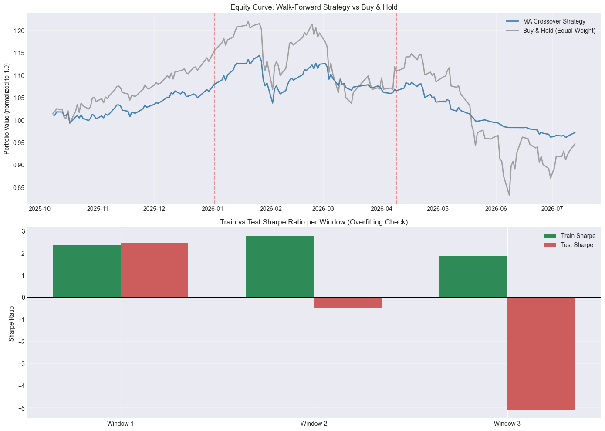

# LQ45 Systematic Backtesting Engine

**Project 4 of 5.** A backtesting engine with walk-forward validation and transaction costs, used to test whether a moving-average crossover strategy on LQ45 stocks survives out-of-sample.

## Problem

A strategy optimized on historical data almost always looks good in-sample. The real question is whether the chosen parameters still work on data the model has never seen. This project builds the engine to answer that honestly.

## Data

- **Universe:** 44 LQ45 stocks (same as Project 3, AADI excluded), benchmark IHSG
- **Period:** 13 Sep 2024 – 15 Sep 2026 (474 trading days after cleaning)
- **Source:** Yahoo Finance via `yfinance`

## Method

1. **Signal:** MA crossover, long when the short MA is above the long MA, flat otherwise
2. **Walk-forward validation:** 250-day train / 60-day test / 60-day step → 3 non-overlapping out-of-sample windows
3. **Parameter optimization per window:** grid search over short MA {5, 10, 15, 20} × long MA {30, 50, 75, 100}, choosing the best Sharpe on train data
4. **Out-of-sample backtest:** apply the chosen parameters to the test window, with **0.15% transaction cost** per trade
5. **Evaluation:** Sharpe, total return, max drawdown, win rate, and comparison with equal-weight buy & hold

## Key results

| Window | Test period | Best MA | Train Sharpe | Test Sharpe | Test return | Max DD |
|---|---|---|---|---|---|---|
| 1 | Oct 2025 – Jan 2026 | 10 / 75 | 2.34 | 2.44 | +7.96% | −2.52% |
| 2 | Jan – Apr 2026 | 5 / 75 | 2.75 | −0.51 | −1.32% | −9.29% |
| 3 | Apr – Jul 2026 | 5 / 30 | 1.86 | −5.09 | −8.79% | −11.34% |

- **Clear overfitting:** average Sharpe drops from **2.32 (train) to −1.05 (test)**, with a test Sharpe standard deviation of 3.79.
- **Unstable parameters:** each window picks a different "optimal" MA pair, so no combination captures a repeatable pattern.
- **Only 1 of 3 windows** has a positive test Sharpe.
- **Defensive side effect:** combined strategy return was **−2.83% vs −5.33% for buy & hold**, mainly because the strategy stepped aside during the sharp market drop in window 3.

## Takeaways

1. A plain MA crossover is **not a robust alpha source** on this universe and period.
2. **Walk-forward validation did its job:** it exposed a strategy that looks strong in-sample but fails out-of-sample, which a single full-history backtest would hide.
3. The strategy works more as a **risk-reduction mechanism** (exiting on negative momentum) than as a return generator.

## Limitations

- Only 3 windows because of the 2-year data length, which limits statistical power.
- Small parameter grid (16 combinations).
- Single strategy; not yet compared with mean reversion or multi-factor rules.
- Binary, equal-weight position sizing; no beta- or volatility-based sizing.

## Next step in the workflow

[Project 5](../05-jii-time-series-forecasting/) reuses this walk-forward framework to test whether statistical and ML models can forecast returns and volatility.

## Run

Open `lq45_systematic_backtesting_engine.ipynb` after installing the root `requirements.txt`.
