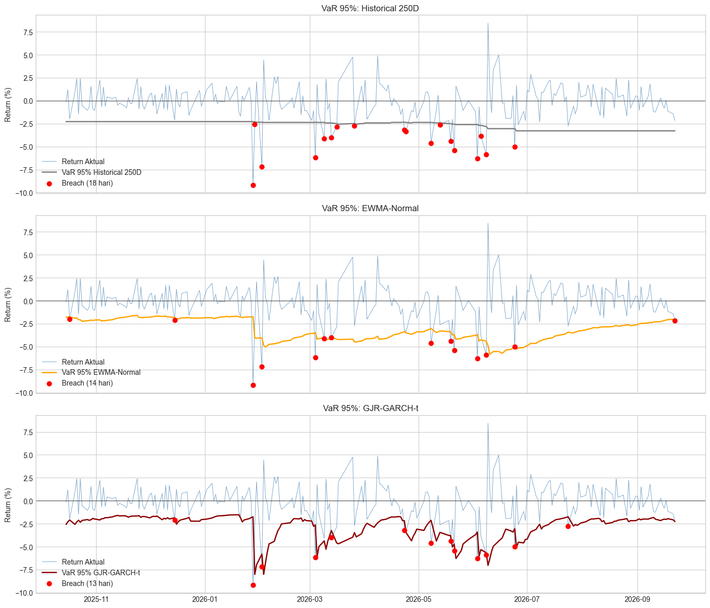

# JII Time Series Forecasting: Return & Volatility

**Project 5 of 5.** Tests whether daily returns and volatility of the Jakarta Islamic Index (JII) can be forecast, compares GARCH models with machine learning under walk-forward validation, and applies the best model to dynamic Value-at-Risk.

## Problem

Can we predict *where* the market goes (return) or *how turbulent* it will be (volatility)? If volatility is predictable, can it produce better risk estimates than the static VaR in Project 3?

## Data

- **Universe:** 30 JII constituents (2 Jun – 30 Nov 2026 composition); RATU and AADI dropped for late listing, leaving **28 stocks**, plus the JII index (`^JKII`)
- **Period:** 23 Sep 2024 – 22 Sep 2026, 472 daily log returns
- **Split:** first 250 days for training, 223 days for walk-forward testing

## Method

1. **Stylized facts:** normality (Jarque-Bera), stationarity (ADF), autocorrelation (Ljung-Box), ARCH effects (ARCH-LM)
2. **Return forecasting:** ARIMA order chosen by AIC, walk-forward one-step-ahead, compared with zero and historical-mean forecasts
3. **Volatility models:** GARCH(1,1)-Normal, GARCH(1,1)-t, GJR-GARCH(1,1)-t
4. **Machine learning:** Random Forest on 12 lagged features (index and cross-sectional stock features), deliberately untuned to avoid overfitting
5. **Formal evaluation:** RMSE, MAE, QLIKE, and Diebold-Mariano tests against EWMA (RiskMetrics), rolling 22-day, and historical volatility baselines
6. **Application:** walk-forward VaR at 95% and 99% (Historical 250D vs EWMA-Normal vs GJR-GARCH-t) backtested with Kupiec, Christoffersen, and conditional coverage tests

## Key results

**Returns are not predictable.** AIC selects ARIMA(0,0,0). Out-of-sample RMSE is identical to a "return = 0" forecast (0.0206), and directional accuracy is 49.3%, no better than a coin flip. This is consistent with weak-form market efficiency.

**Volatility is predictable.** JII returns show fat tails (excess kurtosis 4.58), negative skew (−0.68), and strong ARCH effects (p ≈ 0), found in 21 of 29 series.
- **GJR-GARCH(1,1)-t** has the best AIC and captures a **leverage effect**: negative shocks raise volatility (γ = 0.28), positive shocks do not (α ≈ 0).
- Distribution choice changes conclusions: the estimated shock half-life is ~24 days under a normal distribution vs ~4 days under Student-t.

**Forecast evaluation (223 test days, lower is better)**

| Rank | Model | QLIKE |
|---|---|---|
| 1 | **GJR-GARCH(1,1)-t** | **2.373** |
| 2 | GARCH(1,1)-Normal | 2.433 |
| 3 | GARCH(1,1)-t | 2.436 |
| 4 | Random Forest | 2.445 |
| 5 | EWMA (0.94, RiskMetrics) | 2.472 |
| 6 | Rolling 22D | 2.562 |
| 7 | Historical Vol | 2.584 |

The ranking is **GARCH > ML > baselines**. GJR-GARCH-t beats every other model on QLIKE, but the Diebold-Mariano difference is statistically significant only against Rolling 22D (p = 0.038). Random Forest cannot extrapolate beyond its training range and misses the leverage effect.

**Dynamic VaR (Rp 1B portfolio, 223 test days)**

| Method | VaR 95% breaches | Passes all 95% tests | VaR 99% breaches | Passes all 99% tests | Consecutive breaches (95%) |
|---|---|---|---|---|---|
| Historical 250D (Project 3 method) | 18 (8.07%) | ❌ fails conditional coverage | 4 (1.79%) | ✅ | 4 |
| EWMA-Normal | 14 (6.28%) | ✅ | 6 (2.69%) | ❌ fails Kupiec | 0 |
| **GJR-GARCH-t** | **13 (5.83%)** | ✅ | **5 (2.24%)** | ✅ | **0** |

- **GJR-GARCH-t is the only method that passes every test at both confidence levels**, with the lowest average 99% VaR reserve (Rp 44.6 M vs 54.7 M for historical).
- Dynamic VaR **removes the consecutive breaches** that clustered in early 2026 under the static method from Project 3.

## Limitations

- Short sample (~2 years, 223 test days) limits the power of Diebold-Mariano and 99% VaR tests.
- Squared daily returns are a noisy proxy for true volatility.
- Survivorship bias: the 2026 constituent list is applied to the full period.
- No structural breaks or regime switching modeled.
- Random Forest was intentionally left untuned.

## Possible extensions

Intraday realized volatility with HAR-RV, regime-switching GARCH, DCC-GARCH for portfolio-level VaR, and Expected Shortfall backtesting.

## Run

Open `jii_time_series_forecasting.ipynb` after installing the root `requirements.txt`. The walk-forward cells refit models daily and take a few minutes.
